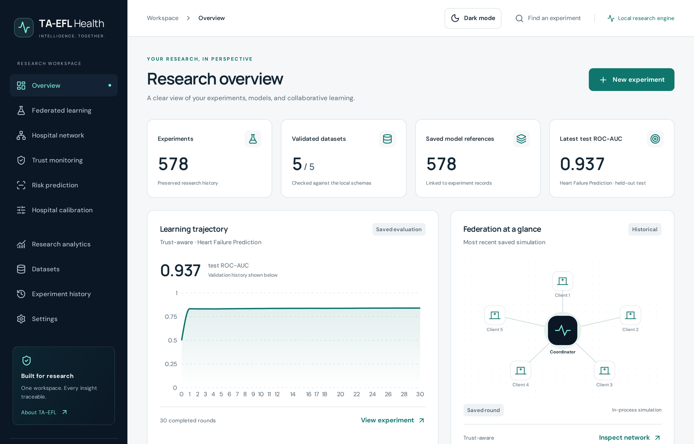
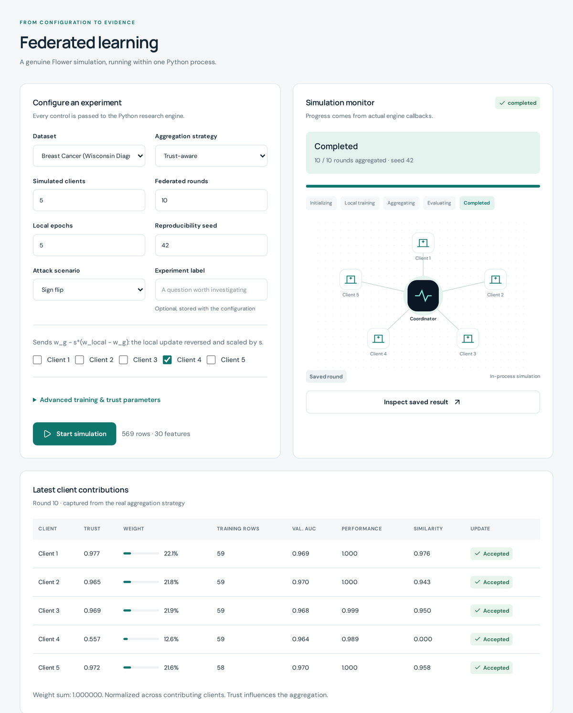
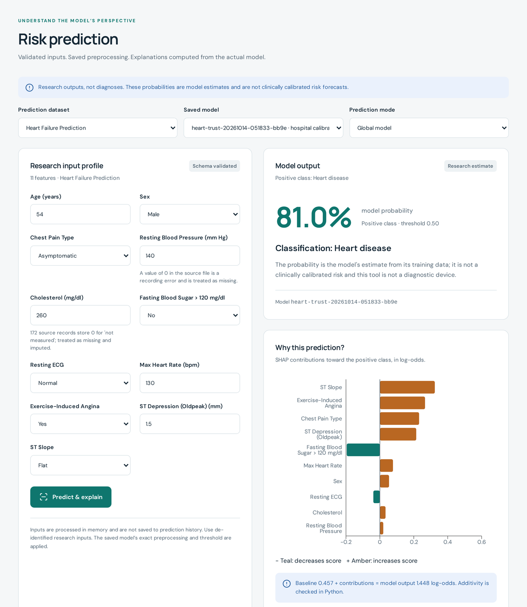

# TA-EFL Health

**Trust-Aware Explainable Federated Learning for Personalized Healthcare Risk Prediction**


TA-EFL Health is a research system for training clinical risk models across several hospitals without moving patient records. It runs genuine [Flower](https://flower.ai) federated learning, protects the shared model with a **trust-aware aggregation rule**, explains every prediction with **SHAP**, and lets each hospital **recalibrate** the frozen global model for its own patients. A React web workspace on top of the Python engine makes every step visible: configuring runs, watching trust change round by round, comparing experiments and inspecting explained predictions.



> **Research prototype.** All hospitals run as an in-process simulation on one machine. Model outputs are research estimates, not diagnoses or clinically validated risks.

## Contents

- [Key features](#key-features)
- [Results at a glance](#results-at-a-glance)
- [Screenshots](#screenshots)
- [Getting started](#getting-started)
- [Reproducing the experiments](#reproducing-the-experiments)
- [Testing](#testing)
- [Project structure](#project-structure)
- [Documentation](#documentation)
- [Scope and limitations](#scope-and-limitations)
- [Team](#team)

## Key features

- **Federated learning with Flower 1.26.** Five simulated hospitals train a logistic regression model locally; the server aggregates with FedAvg, the coordinate-wise median, or the trust-aware rule. Four attacks (sign flipping, update scaling, Gaussian noise, label flipping) can be assigned to any hospital.
- **Trust-aware aggregation.** Every round the server scores each hospital from two measurements it makes itself: validation ROC-AUC relative to the median hospital, and cosine agreement with the coordinate-wise median update. Trust is smoothed across rounds; hospitals below the threshold are excluded and the rest are weighted by trust × data size. Every score and weight is logged for audit.
- **Leakage-safe federated preprocessing.** Hospitals share only summary statistics; the server rebuilds exactly the transform that pooled training data would produce. Validation and test rows are never used for fitting.
- **Explanations.** Exact SHAP contributions (log-odds) for every prediction, with additivity checked in tests.
- **Hospital-specific calibration.** An optional step fits `P = sigmoid(a·z + b)` on each hospital's own calibration rows, leaving the global model untouched and the within-hospital ranking unchanged. See [docs/PERSONALIZATION.md](docs/PERSONALIZATION.md).
- **Web workspace.** Overview, federated learning, hospital network, trust monitoring, risk prediction, hospital calibration, research analytics, dataset library, experiment history (PDF/HTML/JSON reports) and settings, with light and dark themes.
- **Reproducibility.** Every experiment is saved with its full configuration, dataset SHA-256 fingerprint, split sizes and per-round trust table.

## Results at a glance

Five public datasets, three strategies, four attacks plus a no-attack baseline, seeds 1–3 (225 federated runs). Five IID hospitals, 30 rounds, hospital 5 attacking. Test ROC-AUC, mean of three seeds:

| Attack | Dataset | FedAvg | FedMedian | Trust-aware |
|---|---|---:|---:|---:|
| None | Heart failure | 0.902 | 0.902 | 0.902 |
| Sign flipping | Heart failure | 0.790 | 0.900 | 0.891 |
| Sign flipping | Stroke | 0.599 | 0.808 | 0.784 |
| Gaussian noise | Heart failure | 0.607 | 0.902 | 0.888 |
| Gaussian noise | Diabetes | 0.494 | 0.811 | 0.780 |

- The trust-aware rule recovered most of the accuracy FedAvg lost and never gave an honest hospital zero weight (0 of 9,450 honest hospital-rounds).
- The coordinate-wise median matched or slightly exceeded it under sign flipping and Gaussian noise; the trust rule's distinctive value is a per-hospital, per-round audit trail.
- Under strong label skew (Dirichlet α = 0.5), hospital calibration lowered the Brier score and ECE on all five datasets; only 21 of 45 simulated hospitals had enough local data to be calibrated.

Full tables: [docs/RESULTS.md](docs/RESULTS.md) and [docs/PERSONALIZATION.md](docs/PERSONALIZATION.md).

## Screenshots

| Federated learning: configuration, live monitor and per-hospital trust | Risk prediction with SHAP explanation |
|---|---|
|  |  |

All screenshots are captures of the running application.

## Getting started

**Requirements:** Windows 10/11, Python 3.12 (64-bit), Node.js 22.12 or newer. Tested with Python 3.12.10 and Node 24.18.0.

```powershell
git clone https://github.com/MohitKhajuria-jk/ta-efl-health.git
cd ta-efl-health

# Python environment
py -3.12 -m venv .venv
.\.venv\Scripts\python.exe -m pip install -r requirements-web.txt

# Datasets (see "Datasets" below)
.\.venv\Scripts\python.exe scripts\fetch_datasets.py
.\.venv\Scripts\python.exe scripts\check_datasets.py

# Web frontend
cd web
npm.cmd ci
npm.cmd run build
cd ..

# Start
.\.venv\Scripts\python.exe main.py
```

Open **http://127.0.0.1:8780**. On first start the workspace asks you to create a local account. To use another port, set `$env:TA_EFL_PORT='8783'` before starting. Forgotten passwords can be reset locally with `scripts\reset_password.py YOUR_USERNAME`.

For frontend development, keep the backend running and start Vite in `web/` with `npm.cmd run dev` (http://127.0.0.1:5173, proxied to the API). `requirements-lock.txt` records the exact tested Python environment and `web/package-lock.json` pins the JavaScript dependencies.

### Datasets

Dataset files are **not** included in this repository; download them once with `scripts\fetch_datasets.py` (Pima diabetes is fetched automatically and SHA-256 verified; the Kaggle datasets use the Kaggle CLI if configured, otherwise exact manual steps are printed). Breast cancer ships with scikit-learn. Every file is validated against its schema before use.

| Dataset | Records | Positive | Features | Source |
|---|---:|---:|---:|---|
| Heart Failure Prediction | 918 | 508 | 11 | [Kaggle](https://www.kaggle.com/datasets/fedesoriano/heart-failure-prediction) |
| Pima Indians Diabetes | 768 | 268 | 8 | UCI distribution (pinned mirror) |
| Breast Cancer Wisconsin (Diagnostic) | 569 | 212 | 30 | scikit-learn |
| Framingham CHD | 4,240 | 644 | 15 | [Kaggle](https://www.kaggle.com/datasets/aasheesh200/framingham-heart-study-dataset) |
| Stroke Prediction | 5,110 | 249 | 10 | [Kaggle](https://www.kaggle.com/datasets/fedesoriano/stroke-prediction-dataset) |

Respect each dataset's licence and terms of use. Details: [data/README.md](data/README.md).

## Reproducing the experiments

Experiment records, models and reports are written to `storage/` (not tracked by Git). A fresh clone therefore starts with an empty history; the published numbers are in [docs/RESULTS.md](docs/RESULTS.md).

```powershell
# Robustness benchmark: all datasets x strategies x attacks x seeds 1-3
.\.venv\Scripts\python.exe scripts\run_benchmarks.py
# Optional: trust-only run with the original absolute performance signal
.\.venv\Scripts\python.exe scripts\run_benchmarks.py --strategies trust --trust-mode absolute
# Rebuild docs/RESULTS.md from the benchmark files on this machine
.\.venv\Scripts\python.exe scripts\build_results.py

# Hospital-calibration study on the frozen no-attack models of a benchmark
.\.venv\Scripts\python.exe scripts\run_personalization.py --benchmark <benchmark-name>
.\.venv\Scripts\python.exe scripts\run_personalization.py --benchmark <benchmark-name> --alpha 1.0
.\.venv\Scripts\python.exe scripts\run_personalization.py --benchmark <benchmark-name> --partition iid
```

`<benchmark-name>` is the file name (without extension) written to `storage\benchmarks\` by `run_benchmarks.py`. Single experiments can also be run from the web workspace or with `run_experiment.py`.

## Testing

```powershell
$env:QT_QPA_PLATFORM='offscreen'
$env:FLWR_TELEMETRY_ENABLED='0'
.\.venv\Scripts\python.exe -m pytest -q

cd web
npm.cmd run build
npx.cmd playwright install chromium
npm.cmd run test:e2e
```

The Python suite (202 tests on Windows) covers datasets and preprocessing, leakage, metrics, Flower messaging, attacks, every trust formula, FedAvg and FedMedian, SHAP additivity, calibration, the web API and the desktop interface. Dataset-specific tests are skipped until the CSV files are downloaded. The Playwright suite (16 tests) drives a real Chromium browser against a temporary server with disposable data and checks accessibility. Recorded outcomes: [docs/VERIFICATION.md](docs/VERIFICATION.md).

## Project structure

```text
api/            FastAPI application: routes, sessions, research adapters, background jobs
federated/      Flower server runner, aggregation strategies, trust scoring, hospital clients, attacks
ml/             datasets and schemas, preprocessing, logistic model, metrics, SHAP, personalisation
experiments/    experiment store and parameter sweeps
web/            React + TypeScript workspace (Vite, Tailwind, Recharts) and Playwright tests
app/            shared services (accounts, reports) and the original PyQt6 desktop interface
scripts/        dataset download/check, benchmarks, results builder, personalisation study, tools
tests/          pytest suite
docs/           architecture, API, results, personalisation, security and verification notes
data/           dataset folder (CSV files are downloaded, not committed)
main.py         starts the web application
desktop.py      starts the legacy desktop application
```

## Documentation

| Document | Contents |
|---|---|
| [WEB_ARCHITECTURE.md](docs/WEB_ARCHITECTURE.md) | System architecture, job lifecycle and security model |
| [API.md](docs/API.md) | HTTP routes and data contracts |
| [RESULTS.md](docs/RESULTS.md) | Full robustness benchmark tables |
| [PERSONALIZATION.md](docs/PERSONALIZATION.md) | Hospital-specific calibration: method, protocol and results |
| [VERIFICATION.md](docs/VERIFICATION.md) | Test results, recomputation checks and reproducibility |
| [SECURITY.md](docs/SECURITY.md) | Security controls and dependency advisories |
| [DESKTOP.md](docs/DESKTOP.md) | The legacy PyQt6 desktop application |
| [DESIGN_SOURCES.md](docs/DESIGN_SOURCES.md) | Design resources and asset provenance |
| [CHANGELOG.md](docs/CHANGELOG.md) | Version history |

## Scope and limitations

- One workstation, one simulation at a time; hospitals are simulated partitions of public datasets, not deployed sites.
- No secure aggregation or differential privacy; model updates could still leak information.
- The trust rule assumes an honest majority and a small trusted validation set at the server. It does not detect the update-scaling attack, and low trust is a policy decision, not proof of malicious behaviour.
- The datasets are small, public and in some cases decades old. Calibrated probabilities are still research estimates.
- Not a medical device and not clinically validated.

For remote hosting, read [SECURITY.md](docs/SECURITY.md) first (authenticated HTTPS reverse proxy, exact allowed hosts, secure cookies).

## Team

Final-year project, Department of Computer Science and Engineering, Sai Vidya Institute of Technology, Bengaluru.

- Manjunath K R
- Mohit Khajuria
- Prem Kumar S
- Sahil Kumar

With Dr. H. R. Ravikumar and Lalitha K, Assistant Professors, Department of CSE.

## Version history

The original PyQt6 desktop prototype (August 2026) is preserved in the Git history under the tag [`v1.0-desktop-prototype`](https://github.com/MohitKhajuria-jk/ta-efl-health/tree/v1.0-desktop-prototype). Changes since then are listed in [docs/CHANGELOG.md](docs/CHANGELOG.md).
